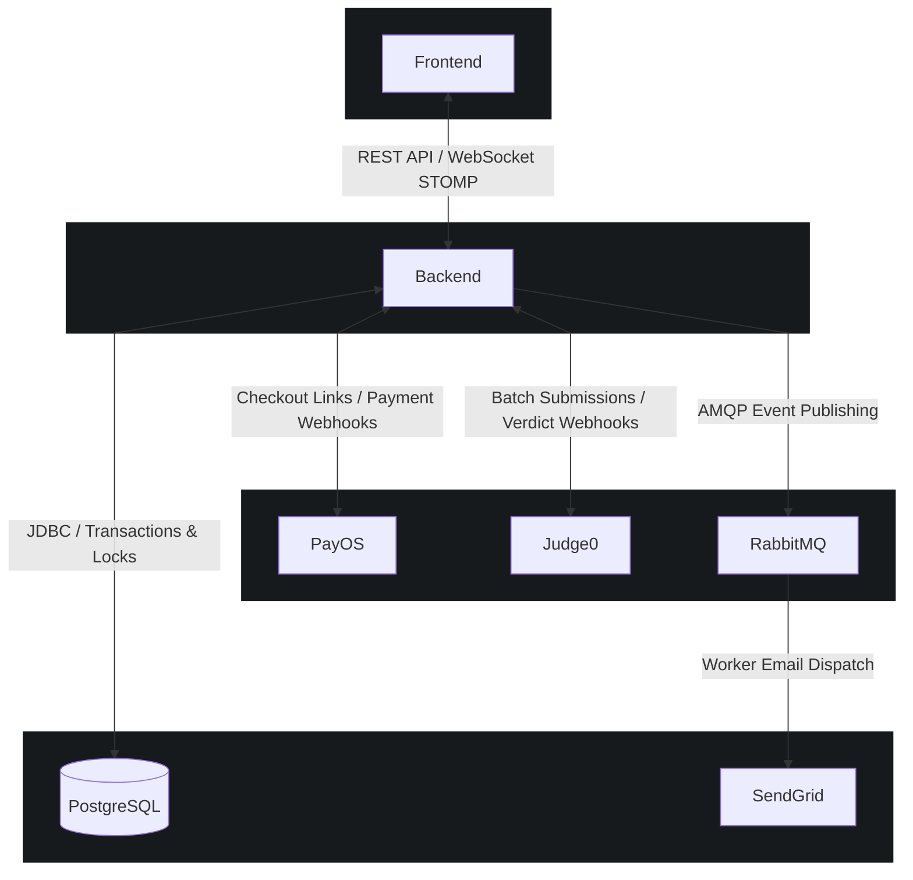

<h1 align="center">
  
  <span style="vertical-align: middle;">CodeLearning</span>
</h1>

<div align="center">
  <a href="https://www.codelearning.io.vn/" target="_blank">
    
  </a>

  <br/>

  [](https://spring.io/projects/spring-boot)
  [](https://www.oracle.com/java/technologies/downloads/)
  [](https://www.postgresql.org/)
  [](https://redis.io/)
  [](https://www.rabbitmq.com/)
  [](https://www.docker.com/)
  [![PayOS](https://img.shields.io/badge/PayOS-VietQR-15AB64.svg?logo=data%3Aimage/svg%2Bxml%3Bbase64%2CPHN2ZyB4bWxucz0iaHR0cDovL3d3dy53My5vcmcvMjAwMC9zdmciIHZpZXdCb3g9IjQwIDEwIDE4NSAxNzUiPjxwYXRoIGZpbGw9IiMxNWFiNjQiIGQ9Ik0yMTUuMjQgNTguMDhjLTEwLjE2LTQxLjQtNDkuNDItNDIuNjktODUuMTItNDEuNjktMjEuMjUuNTktNDMuNTMgMi42OC01OC4wNSAyMC4wMS0xNS4zNCAxOC4zMS0xNC4xNyA1MS44My0xMy4xNCA3NC40NCAyLjEyIDQ2LjM5IDE5LjI4IDYzLjAyIDY1LjUxIDY1LjExIDM1LjUxIDEuNiA3OC40NCAyLjU3IDkwLjE2LTM4Ljg0IDUuMzctMTguOTggNS4zNC01OS44NC42NC03OS4wMlptLTM0LjUzIDc1LjA1Yy0xLjkyIDEuODktNC4zOCAzLjQzLTYuNTUgNS4wMy0xLjAxLjcyLS45OS0uNDYtLjk4LTEuMTktLjA0LTkuMDYtMTMuMTQtNC45My0xOS4wMS00LjU2LTUuMDUuNDgtMTAuOTkuMjctMTQuNC0zLjc2LS42OC0uNzctMS4yNC0uNzktMS45My0uMDQtOC4xNyAxMC42MS0zMi4zNC01LjItMzMuOSA4LjQ3LS4wNC44LS4zNCAxLjc5LTEuMyAxLjItMS45OS0xLjE2LTMuOS0yLjY2LTUuNy00LjExLTEuMDgtLjc5LTEuMTgtMi4xNi0uNzItMy40MSA0LjQyLTEzLjk5IDIwLjY0LTguNTcgMzEuNzQtNy45OCA0LjczLjAxIDYuNDctMi41NiA2LjYzLTYuOTEuMDUtMS4xNi45NC0xLjUyIDIuMDgtMS40OGguMTNjMS40OS0uMDIgMy4zMy0uMDQgNC44Ni4wNS41My4wMy44OS4zNiAxLjA1Ljg0LjE1LjUuMTcgMS4wMS4yMiAxLjU0LjQ2IDcuODYgNy42OSA1Ljg0IDEyLjg2IDUuNDEgNy43OS0xLjA5IDE3LjY3LTIuOTYgMjMuMDMgNC4xOCAxLjE2IDEuNjQgMy4zNiA0Ljk0IDEuODkgNi43Mm0tOS44Mi0xNC41NmMtMi4yOS0uMi00LjkzLS4zOC03LjI5LS4yNS00LjU0LjE3LTEwLjQyIDEuOTItMTUuMDggMS4zOS0xLjE0LS4wNy0yLjE0LS42Mi0yLjM4LTEuNzctLjQxLTEuNzIuMDItMy45NC0xLjE2LTUuMjItMS40Mi0xLjU2LTMuNjQtLjk1LTUuNjItMS4xNy0yLjU3LjAzLTYuNzEtLjctNy43NCwyLjM2LS41NiAyLjcxLjM3IDYuMS0zLjY1IDUuODktMy43My0uMDctNy42MS0uNzYtMTEuNDUtMS4xOS0zLS4zMy01LjktLjU1LTguODItLjE0LTEuMDYuMTMtMi4xNy4yNS0zLjIyLS4wNC00LjU2LTEuNjktOC41LTUuMTYtMTEuMzItOS4xLTQuODUtNi41Mi00LjQ1LTE1LjI1LTIuNTUtMjIuODYgMi40OC0xMC40MyA0LjgxLTIxLjY0IDcuODItMzEuOTQuMzctLjYxIDEuMjktLjA1IDEuODMuMzcgMjMuMTIsMTYuNjQgNTQuODcsMTUuNDEgNzcuODItLjYzLjQ2LjA2LjcxLjg5LjgzIDEuNDEsMy4xOCAxMi45OCA3LjA3IDI2LjI1IDguODMsMzkuNDl2LjE0Yy45OSA5LjYtNy4xNyAyMS44NC0xNi44NCAyMy4yNloiLz48cGF0aCBmaWxsPSIjMTVhYjY0IiBkPSJNMTMwLjQxIDg2LjczYy0uMzgtLjExLS43My0uMTktMS4zOC4wNy0xLjMzLjUzLTIuNTguOTUtNC41MSAxLjA5LTYuMjUuNDUtMTEuODMtMy4yNS0xNC4wNS04Ljc3LS40Ny0xLjE4LTIuMDEtMS41MS0yLjktLjYxYTEzLjk4IDEzLjk4IDAgMCAwLTQuMDIgMTEuMTdjLjY2IDcuMjUgNi45NSAxMi45IDE0LjIzIDEyLjc2IDcuNzktLjE1IDEzLjg0LTYuNTMgMTMuNzktMTQuMTEgMC0uMzgtLjE1LS44Mi0uNDUtMS4xLS4xNS0uMTQtLjM3LS4zOC0uNzEtLjQ5Wk0xNjYuODYgNzkuMTJjLTIuMjEgNS41Mi03LjggOS4yMi0xNC4wNSA4Ljc3LTEuOTItLjE0LTMuMTgtLjU3LTQuNTEtMS4wOS0uNjUtLjI2LTEuMDEtLjE4LTEuMzgtLjA3LS4zNC4xLS41Ny4zNS0uNzEuNDktLjMuMjgtLjQ1LjczLS40NSAxLjEtLjA1IDcuNTggNiAxMy45NiAxMy43OSAxNC4xMSA3LjI4LjE0IDEzLjU3LTUuNTEgMTQuMjMtMTIuNzYuMzktNC4zMS0xLjIxLTguMzMtNC4wMi0xMS4xNy0uOS0uOS0yLjQzLS41Ni0yLjkuNjFaIi8%2BPC9zdmc%2B)](https://payos.vn/)
  [](https://react.dev/)
  [](https://www.typescriptlang.org/)
  [](https://vitejs.dev/)
  [](https://tailwindcss.com/)
</div>

## Overview

CodeLearning is an e-learning and competitive programming platform that helps learners build programming skills through video-based courses and exercises. It includes an Online Judge for practicing data structures and algorithms, along with ICPC-style programming contests featuring structured rules, real-time rankings, and competitive workflows.

## Key Features

| Feature | Description                                                                                                                                                                                                                              |
| :--- |:-----------------------------------------------------------------------------------------------------------------------------------------------------------------------------------------------------------------------------------------|
| **Online Judge & Automated Grading** | In-browser code editor supporting C++, Java, Python, and JavaScript. Users write, test, and submit code to receive instant verdicts (`Accepted`, `Wrong Answer`, `Time Limit Exceeded`, etc.) with real-time testcase progress tracking. |
| **Competitive Contests** | Hosts ICPC-style programming contests with automated timers, penalty-based scoring, and live leaderboards featuring a freeze phase during the final minutes to maintain competitive suspense.                                            |
| **Interactive Courses & E-Learning** | Structured curriculum organized into chapters, video lectures, and quizzes. Hands-on coding exercises are integrated directly alongside lessons with personal learning progress tracking.                                                |
| **Cart, Wallet & Payments** | Multi-item shopping cart with voucher discounts, direct bank transfer via VietQR dynamic QR codes, and an internal virtual wallet for balance top-ups and one-click checkout.                                                            |
| **Authentication & Role-Based Portals** | Supports email/password login and Google Single Sign-On (SSO), providing role-based workflows and permission controls for Students, Instructors, and Administrators.                                                                     |
| **Automated Notifications & Emails** | Sends automated email notifications for account confirmations, course enrollments, payment receipts, and platform announcements.                                                                                                         |
| **Automated Testcase Generator** | Enables instructors to generate comprehensive test suites automatically using an input generator script and a reference solution.                                                                                                        |

## System Architecture

### High-Level Architecture



### Monorepo Directory Structure

```text
CodeLearning/
├── backend/                      # Spring Boot 3.5.7 Backend Application (Java 21)
│   ├── src/main/java/com/thanhmila/codelearning/
│   │   ├── configuration/        # Bean definitions (Redis, RabbitMQ, WebClient, PayOS, WebSocket)
│   │   ├── controller/           # REST Controllers grouped by domain
│   │   │   ├── auth/             # Authentication, token rotation, SSO endpoints
│   │   │   ├── contest/          # Contest lifecycle, problem sets, submissions, leaderboard
│   │   │   ├── course/           # Courses, chapters, lessons, video, quizzes
│   │   │   ├── oj/               # Online Judge problems, submissions, testcases
│   │   │   └── payment/          # Cart, orders, wallet, PayOS callbacks
│   │   ├── dto/                  # Data Transfer Objects (Request / Response payloads)
│   │   ├── entity/               # JPA Entities mapped to PostgreSQL
│   │   ├── exception/            # Centralized exception handlers (GlobalExceptionHandler)
│   │   ├── listener/             # RabbitMQ message consumers
│   │   ├── mapper/               # MapStruct mappers (Entity <-> DTO)
│   │   ├── repository/           # Spring Data JPA repositories (Projections, Specifications)
│   │   ├── scheduler/            # Scheduled tasks (reconciliation, token cleanup)
│   │   ├── security/             # Spring Security, custom JWT decoder, SpEL evaluators
│   │   └── service/              # Core business logic services
│   ├── Dockerfile                # Multi-stage Docker build for backend
│   ├── Dockerfile.rabbitmq       # RabbitMQ image with delayed exchange plugin
│   └── pom.xml                   # Maven dependencies and plugins
├── frontend/                     # React 19 + TypeScript + Vite Frontend Application
│   ├── src/
│   │   ├── api/                  # Axios HTTP client instances and endpoints
│   │   ├── assets/               # Static media, icons, and illustrations
│   │   ├── components/           # Shared UI components (Monaco Editor, Modals, Navbar)
│   │   ├── context/              # React Context (AuthContext, ThemeContext, CartContext)
│   │   ├── hooks/                # Custom React hooks
│   │   ├── layouts/              # Main application and administration layouts
│   │   ├── locales/              # i18n localization resources (en.json, vi.json)
│   │   ├── pages/                # Route views (Home, OJ, Courses, Contest, Cart, Admin)
│   │   ├── types/                # TypeScript interfaces and type definitions
│   │   └── utils/                # Shared helper functions
│   ├── Dockerfile                # Production NGINX container build
│   └── package.json              # Node.js dependencies and scripts
├── database/                     # Database initialization scripts
│   └── schema-only.sql           # Canonical PostgreSQL schema
├── docs/                         # Technical documentation center
│   └── architecture/             # System architecture and workflow specifications
│       ├── online_judge_workflow.md
│       ├── payment_checkout_workflow.md
│       ├── security_authorization_workflow.md
│       ├── email_pipeline_workflow.md
│       ├── contest_scheduling_workflow.md
│       └── testcase_generation_workflow.md
├── docker-compose.dev.yml        # Orchestration for development environment
├── docker-compose.prod.yml       # Orchestration for production deployment
├── judge0.conf                   # Judge0 sandbox configuration
└── README.md                     # Main repository documentation
```

## Getting Started

### Prerequisites

Ensure the following tools are installed on your environment:
* [Docker and Docker Compose](https://www.docker.com/) (Required for containerized runtime)
* [JDK 21](https://www.oracle.com/java/technologies/downloads/) (Required for local backend development)
* [Node.js 20+](https://nodejs.org/) and `npm` (Required for local frontend development)

### 1. Environment Configuration

#### Backend Configuration (`backend/.env`):
Create a `.env` file in the `backend/` directory:
```env
# POSTGRES DATABASE
DB_HOST=localhost
DB_PORT=5432
DB_NAME=codelearning
DB_USERNAME=postgres
DB_PASSWORD=your_secure_password

# REDIS CACHE
REDIS_HOST=localhost
REDIS_PORT=6379

# RABBITMQ
RABBITMQ_HOST=localhost
RABBITMQ_PORT=5672
RABBITMQ_USERNAME=guest
RABBITMQ_PASSWORD=guest

# SECURITY & JWT
JWT_SIGNER_KEY=your_super_secret_32_characters_key_here

# CLOUDINARY CONFIGURATION
CLOUDINARY_CLOUD_NAME=your_cloudinary_name
CLOUDINARY_API_KEY=your_cloudinary_key
CLOUDINARY_API_SECRET=your_cloudinary_secret

#PAYOS CONFIGURATION
PAYOS_CLIENT_ID=your_payos_client_id
PAYOS_API_KEY=your_payos_api_key
PAYOS_CHECKSUM_KEY=your_payos_checksum_key

# JUDGE0 SANDBOX (OJ)
JUDGE0_API_URL=http://localhost:2358
JUDGE0_WEBHOOK_URL=http://your-ip-or-domain:8080/codelearning/online-judge/webhooks/submissions (Ngrok)

# SENDGRID CONFIGURATION
SENDGRID_API_KEY=your_sendgrid_api_key
SENDGRID_WEBHOOK_PUBLIC_KEY=your_sendgrid_webhook_public_key
SENDGRID_FROM_EMAIL=your_sendgrid_from_email
SENDGRID_FROM_NAME=your_sendgrid_from_name
```

#### Frontend Configuration (`frontend/.env`):
Create a `.env` file in the `frontend/` directory:
```env
VITE_API_BASE_URL=http://localhost:8080/codelearning
VITE_GOOGLE_CLIENT_ID=your_google_oauth_client_id
```

### 2. Running with Docker Compose (Recommended)

Docker Compose is configured with service healthchecks. Infrastructure components (PostgreSQL, Redis, RabbitMQ, and Judge0) start and verify health before launching the Spring Boot backend and React frontend.

#### Development Environment:
```bash
docker compose -f docker-compose.dev.yml --profile backend --profile frontend --profile judge0 up -d
```

#### Production Environment:
```bash
docker compose -f docker-compose.prod.yml --profile backend --profile frontend --profile judge0 up -d
```

### 3. Running Locally

To run the application manually for development or debugging:

#### Step 1: Start Supporting Infrastructure
```bash
docker compose -f docker-compose.dev.yml up -d db redis rabbitmq judge0-server judge0-workers judge0-db judge0-redis
```

#### Step 2: Start the Backend
```bash
cd backend
./mvnw clean package -DskipTests
./mvnw spring-boot:run
```
The API will be available at `http://localhost:8080/codelearning`.

#### Step 3: Start the Frontend
```bash
cd frontend
npm install
npm run dev
```
The frontend application will be available at `http://localhost:5173`.
